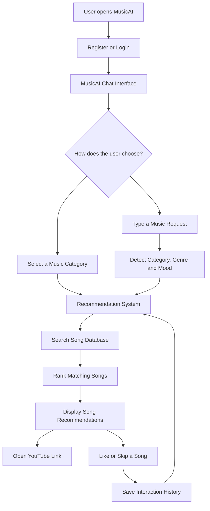
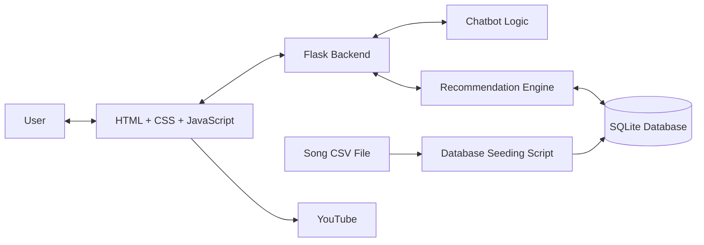
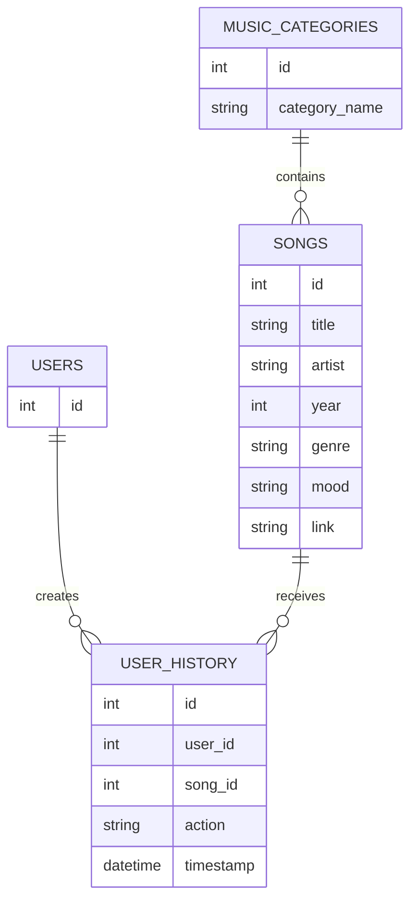

# MusicAI — Personalized Music Recommendation Chatbot

**Discover music based on your mood, favourite genre, and preferred musical era.**

MusicAI is a web-based music recommendation application that helps users discover songs through a simple chatbot. Instead of searching through a large music library manually, users can select a music category or type what they want to listen to.

The application recommends songs, provides YouTube links, and learns from users' Likes and Skips to improve future recommendations.

---

##  Table of Contents

1. [Introduction](#-introduction)
2. [Problem Statement](#-problem-statement)
3. [Project Objectives](#-project-objectives)
4. [How Does MusicAI Work?](#-how-does-musicai-work)
5. [System Architecture](#-system-architecture)
6. [Input and Output](#-input-and-output)
7. [Features](#-features)
8. [Technologies Used](#-technologies-used)
9. [Project Folder Structure](#-project-folder-structure)
10. [Database Design](#-database-design)
11. [Recommendation Logic](#-recommendation-logic)
12. [Installation and Setup](#-installation-and-setup)
13. [Example Usage](#-example-usage)
14. [Current Limitations](#-current-limitations)
15. [Future Improvements](#-future-improvements)
16. [Conclusion](#-conclusion)

---

## Introduction

Have you ever wanted to listen to happy music, relaxing music, or songs from the 1990s but struggled to decide what to play?

MusicAI aims to solve this problem through a chatbot-based music recommendation system.

Users can interact with the application in two ways:

- **Category selection:** Choose a musical era, such as the 80s or early 2000s.
- **Text-based interaction:** Type a request such as "Suggest relaxing classical music."

The application searches its song database, recommends matching songs, and displays available YouTube links.

Users can also Like or Skip songs. These actions are saved in the database and can help the recommendation system learn their preferences.

## Problem Statement

Music libraries contain thousands of songs. Finding suitable music can take time, especially when users know the mood or genre they want but do not know which song to choose.

Traditional browsing often requires users to search for songs individually or apply filters manually.

**MusicAI provides a simpler way to discover music by combining chatbot interaction, song filtering, and basic preference-based recommendations.**

##  Project Objectives

- Build a simple and user-friendly music recommendation website.
- Allow users to select musical eras and express preferences using text.
- Recommend songs based on categories, genres, and moods.
- Provide YouTube links for easy access to songs.
- Record users' Likes and Skips.
- Use saved interaction history to personalize recommendations.
- Demonstrate how Python, databases, and web technologies can work together in an AI-related application.

---

##  How Does MusicAI Work?

The application follows a straightforward process.

1. The user registers or logs in.
2. The chatbot welcomes the user.
3. The user selects a category or types a music request.
4. The application identifies relevant preferences from the request.
5. The recommendation system searches the song database.
6. Matching songs appear in the chat window.
7. The user can open a YouTube link, Like a song, or Skip it.
8. Like and Skip actions are saved in the database and used by the recommendation system.

### System workflow



*Note: This diagram represents the intended interaction flow. The recommendation system uses basic scoring and saved history; it is not a fully trained machine-learning model.*

---

##  System Architecture

MusicAI uses a client-server architecture. This means the website shown to the user communicates with a Python application running on the server, which retrieves information from a database.

| Component | Technology | Purpose |
|---|---|---|
| User interface | HTML | Creates the page structure and chat interface |
| Visual design | CSS | Controls colours, spacing, buttons, and layout |
| Browser interaction | JavaScript | Sends requests, displays songs, and handles Like/Skip actions |
| Application backend | Python with Flask | Processes requests and connects the different components |
| Music database | SQLite | Stores users, songs, categories, and interaction history |
| Song dataset | CSV | Provides song information for database seeding |
| Music access | YouTube links | Allows users to open available songs externally |

### Architecture diagram



---

##  Input and Output

Understanding the input and output helps explain what the application does.

### 1. Inputs

| Input | Example | Purpose |
|---|---|---|
| User details | Name and login information | Supports registration and login |
| Music category | `80s` | Requests songs from a selected era |
| Genre | `rock`, `jazz`, `pop` | Helps narrow down the song selection |
| Mood | `happy`, `sad`, `relaxing` | Helps match songs to a requested mood |
| Natural-language request | "Recommend romantic Bollywood songs from the 90s" | Lets users express preferences in everyday language |
| Like action | Click the heart button | Records a positive preference |
| Skip action | Click the skip button | Records a negative preference |
| Song dataset | `songs.csv` | Supplies song metadata and available links |

### 2. Outputs

| Output | Example | Purpose |
|---|---|---|
| Welcome message | "Welcome back!" | Starts the conversation |
| Chatbot response | "Here are some romantic Bollywood songs from the 90s." | Confirms the interpreted request |
| Recommended songs | Song title, artist, year | Helps users discover music |
| Genre and mood | Jazz, relaxing | Shows available song information |
| YouTube link | A link to a song | Lets the user open the song on YouTube |
| Like confirmation | `❤️ Liked` | Shows that an action was accepted |
| Skip confirmation | `Skipped` | Shows that an action was accepted |
| Interaction history | Liked or skipped song records | Supports future personalization |

**Example:**

Input:

> Recommend relaxing jazz songs from the 80s.

Possible output:

- A chatbot message confirming the request.
- Matching songs available in the database.
- Song titles, artists, and years.
- YouTube links when available.
- Like and Skip buttons for each recommendation.

The actual songs depend on the records available in the database.

---

##  Features

### 1. User registration and login

Users can create an account and log in to access the music chat interface.

### 2. Music category selection

Users can choose from six musical eras:

| Category | Meaning |
|---|---|
| 60s | Music from the 1960s |
| 70s | Music from the 1970s |
| 80s | Music from the 1980s |
| 90s | Music from the 1990s |
| Early 2000s | Music from the early 2000s |
| 2010 onwards | Music from 2010 and later |

### 3. Genre-based recommendations

The system supports these genres:

- Pop
- Rock
- Classical
- Jazz
- Bollywood

### 4. Mood-based recommendations

The chatbot recognizes these mood categories:

- Romantic
- Happy
- Sad
- Energetic
- Nostalgic
- Relaxing

### 5. Natural-language interaction

Users can type a music request instead of selecting a category button.

For example:

- "I want happy pop music."
- "Suggest relaxing songs."
- "Play Bollywood songs from the 90s."

The chatbot uses predefined text-matching rules to identify supported preferences.

### 6. YouTube links

If a song has a stored YouTube URL, the chat displays a link that opens it in a new browser tab.

MusicAI does not currently need to host the audio itself.

### 7. Like and Skip

Users can Like or Skip a recommended song.

These actions are stored in the SQLite database. The recommendation system can use this history to adjust song rankings and avoid recommending songs the user has already liked.

### 8. Basic personalization

The recommendation system uses saved user history to estimate preferences for genres, moods, categories, and artists.

This is a rule-based scoring system rather than a trained recommendation model.

---

##  Technologies Used

| Technology | Role in the project |
|---|---|
| Python | Main programming language |
| Flask | Handles web requests and application routes |
| SQLite | Stores application data |
| HTML | Builds the web page |
| CSS | Styles the application |
| JavaScript | Handles interactive chat behaviour |
| Pandas | Can be used to read and process song CSV data in the seeding workflow |
| CSV | Stores the initial song dataset |
| Mermaid | Creates diagrams for project documentation |

---

##  Project Folder Structure

The following is a simplified representation of the project structure. Your actual filenames may include additional files.

```text
MusicAI/
│
├── app.py
│
├── chatbot/
│   └── chatbot.py
│
├── recommender/
│   └── recommender.py
│
├── database/
│   ├── database.py
│   └── music_ai.db
│
├── data/
│   └── songs.csv
│
├── static/
│   └── css/
│       └── style.css
│
├── templates/
│   ├── chat.html
│   ├── login.html
│   ├── register.html
│   └── index.html
│
├── seed_songs.py
│
├── requirements.txt
│
└── README.md
```

### What does each important file do?

| File or folder | Explanation |
|---|---|
| `app.py` | Starts the Flask application and defines routes for user interactions |
| `chatbot.py` | Detects supported categories, genres, moods, and request intent |
| `recommender.py` | Scores songs and ranks recommendations using preferences and history |
| `database.py` | Creates database tables and provides functions for storing and retrieving data |
| `music_ai.db` | SQLite database containing the application's stored records |
| `songs.csv` | Initial song dataset |
| `seed_songs.py` | Imports song information from the CSV into the database |
| `chat.html` | Defines the chatbot interface and JavaScript interactions |
| `style.css` | Controls the appearance of the website |
| `requirements.txt` | Lists Python packages required to run the application |

---

##  Database Design

MusicAI uses SQLite, a lightweight database that stores information in tables.

The main tables are:

| Table | Information stored |
|---|---|
| `users` | User account information |
| `music_categories` | Supported musical eras |
| `songs` | Song titles, artists, years, categories, genres, moods, and links |
| `user_history` | User actions such as Likes and Skips, including timestamps |

### How are the tables connected?



For example, when a user Likes a song, the application stores the user's ID, the song's ID, the action, and the time of the action in `user_history`.

This allows the application to connect user behaviour with song information.

---

##  Recommendation Logic

The recommendation engine follows a simple scoring approach.

It checks which songs match the user's request and then assigns scores to help rank them.

The current scoring rules include:

| Condition | Score adjustment |
|---|---:|
| Song matches requested genre | +5 |
| Song matches requested mood | +4 |
| Song matches a preferred genre from history | +3 |
| Song matches a preferred mood from history | +2 |
| Song matches a preferred category from history | +2 |
| Song matches a preferred artist from history | +2 |
| Song was previously skipped | -10 |

The scores are combined to rank eligible songs. Songs the user has already liked are normally excluded from the recommendations, although the current implementation has a fallback when all candidates have been excluded.

### Simple example

Suppose a user frequently Likes jazz songs and requests relaxing music.

A jazz song with a relaxing mood may receive points for matching the requested mood and the user's previous genre preference.

A skipped song receives a penalty, making it less likely to rank highly.

The system then returns the highest-ranked available recommendations.

**Important:** These numbers are hand-designed rules, not values learned by training an AI model. A higher score means the song ranks more favourably under the current rules; it does not guarantee that the user will enjoy it.

---

##  Installation and Setup

### Requirements

- Python installed on your computer.
- The MusicAI project files.
- A terminal such as Command Prompt or PowerShell.
- Internet access to install dependencies and open YouTube links.

### Step 1: Open the project folder

Open the project folder in VS Code.

### Step 2: Create a virtual environment

Open the terminal in your project folder and run:

```bash
python -m venv venv
```

Activate it on Windows:

```powershell
.\venv\Scripts\Activate.ps1
```

If PowerShell blocks activation, you can use Command Prompt instead:

```bat
venv\Scripts\activate.bat
```

### Step 3: Install dependencies

If your project contains `requirements.txt`, run:

```bash
python -m pip install -r requirements.txt
```

If the file is missing or incomplete, install the packages listed in your project's actual imports and setup instructions.

### Step 4: Prepare the song dataset

Check that `data/songs.csv` exists and contains the expected song information.

The dataset should include the fields used by your seeding script, such as:

- Song title
- Artist
- Year
- Category
- Genre
- Mood
- YouTube link

Check the actual CSV column names before running the script.

### Step 5: Seed the database

If your project uses the provided seeding script, run:

```bash
python seed_songs.py
```

This imports song information into the SQLite database. The current seeding workflow can update matching songs with information such as their YouTube links instead of creating duplicates.

### Step 6: Start the application

Run:

```bash
python app.py
```

Open the local address shown in the terminal, commonly:

```text
http://127.0.0.1:5000
```

The exact address and port depend on your Flask configuration.

---

##  Example Usage

### Scenario 1: Category-based recommendations

1. Log in to MusicAI.
2. Click the `90s` category button.
3. Read the chatbot response.
4. Browse the recommended songs.
5. Open a YouTube link or Like/Skip a song.

### Scenario 2: Mood-based recommendations

Type:

```text
Suggest relaxing music.
```

The chatbot attempts to identify the mood and return matching recommendations.

### Scenario 3: Genre and era

Type:

```text
Recommend jazz songs from the 80s.
```

The chatbot attempts to identify the genre and category before requesting recommendations.

### Scenario 4: Learning from feedback

1. Request a set of songs.
2. Like a song you enjoy.
3. Skip a song you do not want.
4. Make another request.

The recommendation system can use the saved history to influence future results.

Personalization depends on the history available and the matching rules. It does not guarantee that every future recommendation will be better.

---

##  Current Limitations

MusicAI is a working prototype. It demonstrates the main ideas behind a personalized music recommendation system, but several parts can be improved.

| Limitation | Why it matters | Possible solution |
|---|---|---|
| Limited song dataset | Recommendations are restricted to songs already stored in the database | Expand and regularly maintain the dataset |
| Rule-based language detection | The chatbot may misunderstand unusual wording, spelling mistakes, or complex requests | Add more robust natural-language processing |
| Fixed genres and moods | Users cannot freely define every possible music preference | Add configurable categories and richer metadata |
| Basic recommendation scoring | Fixed weights may not represent each user's actual preferences accurately | Evaluate and tune the ranking algorithm |
| Limited feedback | Like and Skip actions provide only a small amount of information about a user's taste | Add ratings, favourites, and more feedback options |
| YouTube dependency | A link may be unavailable, removed, region-restricted, or incorrect | Validate links and handle unavailable content |
| No built-in audio player | Songs open externally rather than playing inside MusicAI | Consider an appropriate, permitted embedded playback option |
| No advanced context understanding | The chatbot may not understand requests involving several conditions or conversational follow-ups | Add better language understanding and dialogue state |
| Limited recommendation evaluation | The system does not automatically prove that recommendations are relevant or effective | Measure ranking quality and collect user feedback |
| Basic security and deployment | A local prototype may not be ready for public use | Review password handling, sessions, secret keys, input validation, and deployment configuration |

### What the current system does not claim to do

- It does not use a trained deep-learning recommendation model.
- It does not understand every sentence like a human conversation partner.
- It does not automatically retrieve every song available on YouTube.
- It does not guarantee that a recommended song matches a user's emotional state.
- It does not provide clinical or therapeutic music recommendations.

---

##  Future Improvements

The project can be developed gradually, starting with simple changes and progressing to more advanced AI techniques.

### Phase 1 — Improve the current application

**Goal: Make the existing application more reliable.**

- Improve natural-language keyword detection.
- Add more song records and verify YouTube links.
- Prevent repeated recommendations where appropriate.
- Add a dedicated page for liked songs.
- Allow users to undo or change a Like or Skip.
- Improve error messages and input validation.
- Test the application on different screen sizes.

### Phase 2 — Improve personalization

**Goal: Make recommendations more relevant to each user.**

- Build a user profile from listening and feedback history.
- Give users the option to rate songs.
- Tune recommendation weights using test data.
- Add a recommendation explanation, such as "Suggested because you like jazz."
- Compare recommendation quality before and after personalization changes.

### Phase 3 — Improve language understanding

**Goal: Understand more flexible music requests.**

- Add more robust natural-language processing.
- Recognize alternative expressions for moods and genres.
- Support follow-up requests such as "Give me something more energetic."
- Preserve the user's previous preferences during a conversation.
- Explore an LLM-based chatbot if the project's computing resources and budget allow it.

### Phase 4 — Explore machine learning

**Goal: Move beyond manually written recommendation rules.**

Potential approaches include:

- **Content-based filtering:** Recommend songs with characteristics similar to songs the user likes.
- **Collaborative filtering:** Find patterns in the preferences of multiple users.
- **Hybrid recommendation:** Combine song information with user behaviour.
- **Ranking evaluation:** Compare recommendation approaches using appropriate metrics and test datasets.

These are proposed improvements, not features already implemented in the current version.

### Phase 5 — Expand the application

**Goal: Make MusicAI more useful across devices and use cases.**

- Build a mobile-friendly experience or Android application.
- Add an optional favourites playlist.
- Consider permitted music-service integrations.
- Add analytics to measure how often recommendations are liked or skipped.
- Improve database management and backup procedures.
- Deploy the application securely for multiple users.

---

## How Will We Measure Improvement?

New features should be tested rather than judged only by appearance.

| Measurement | What it tells us |
|---|---|
| Like rate | What proportion of shown recommendations receive a Like |
| Skip rate | What proportion of shown recommendations are skipped |
| Recommendation coverage | How much of the available song catalogue gets recommended |
| Repeated recommendation rate | How frequently users see songs they have already received |
| Request success rate | How often the system returns recommendations for supported requests |
| Response time | How long the application takes to respond |
| User feedback | Whether people find the recommendations useful |

For a fair comparison, these measurements should be collected consistently and compared across versions. A high Like rate alone does not prove that the system is better in every way.

---

## Privacy and Responsible Use

MusicAI stores account information and interaction history to support its functionality.

Before deploying it publicly:

- Store passwords securely using an appropriate password-hashing method.
- Keep secret keys out of source control.
- Validate incoming requests on the server.
- Protect user sessions and database access.
- Explain what user information is stored and why.
- Avoid collecting unnecessary personal information.
- Verify that any external music integrations comply with their terms.

---

## Conclusion

MusicAI demonstrates how a web application can combine Python, Flask, SQLite, chatbot logic, and a recommendation engine to make music discovery easier.

Users can request songs by category, genre, or mood, open available YouTube links, and provide feedback through Like and Skip actions. The system uses saved interaction history to personalize its recommendations through a rule-based scoring method.

The next major step is to improve language understanding, evaluate recommendation quality, and gradually introduce more advanced personalization techniques.

**The long-term goal is to develop MusicAI from a simple music recommendation chatbot into a more flexible and genuinely personalized music discovery platform.**

---

## Project Status

**Current stage:** Working prototype with chatbot-based music recommendations, YouTube links, and Like/Skip feedback.

**Next recommended milestone:** Add a *My Liked Songs* view, improve recommendation testing, and document the exact dataset and installation requirements.

